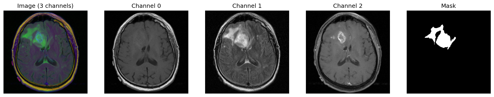
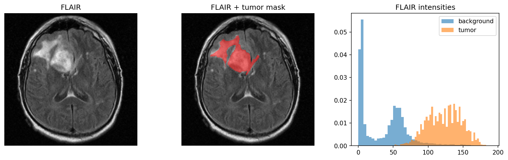
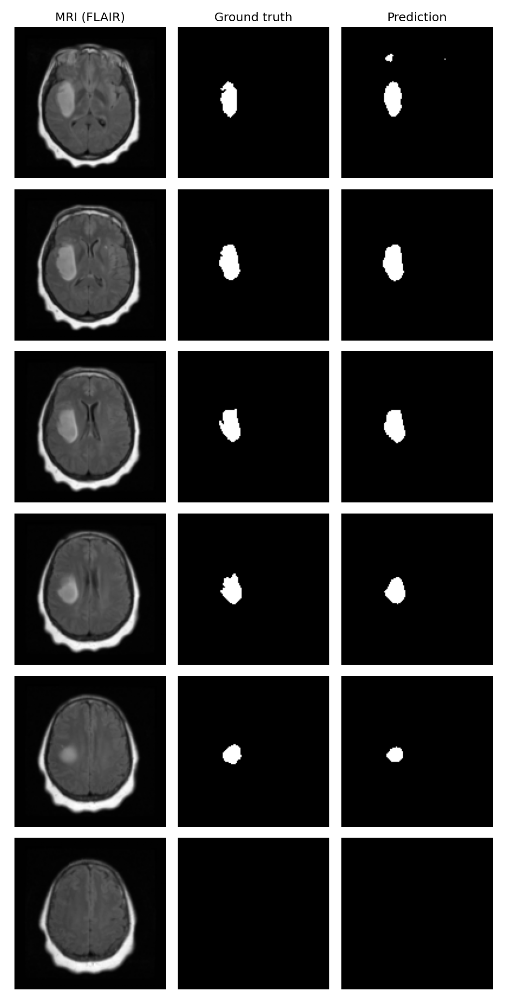
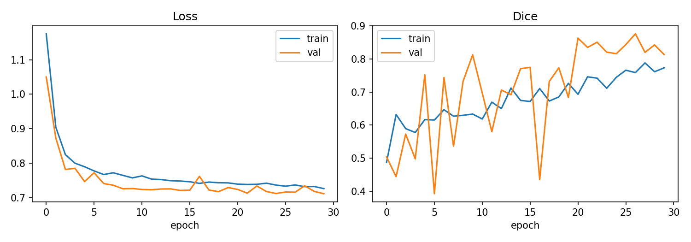

# MRI Segmentation with U-Net (PyTorch)

2D binary segmentation of MRI slices using a U-Net (encoder-decoder with skip connections),
trained with a combined BCE + Dice loss and evaluated with Dice and IoU on a held-out test split.

## Project structure
```
src/
  dataset.py   # image/mask loading, normalisation, augmentation, synthetic toy data
  model.py     # U-Net (DoubleConv, Down, Up blocks; optional Dropout2d)
  losses.py    # BCE+Dice loss, Dice and IoU metrics
  train.py     # training loop, validation, best-checkpoint saving, curves
  evaluate.py  # test-set metrics + prediction visualisation
visualization/ # exploratory data visualisation (channels, mask overlay, intensity histograms)
data/          # Kaggle LGG dataset goes here (see data/README.md)
results/       # training curves, predictions (generated)
```

## Setup
```bash
python -m venv venv
source venv/bin/activate          # Windows: venv\Scripts\activate
pip install -r requirements.txt
```

## Usage
```bash
# 0) Data visualisation
python visualization/data_visualization.py --data_root data --sample TCGA_CS_4941_19960909_14

# 1) Sanity check on synthetic data (no dataset needed)
python -m src.train --synthetic --epochs 5
python -m src.evaluate --synthetic

# 2) Kaggle LGG dataset
python -m src.train --data_root data --epochs 30
python -m src.evaluate --data_root data
```

## Method
- **Data:** Kaggle LGG MRI segmentation (TCGA-LGG): 3-channel slices (pre-contrast, FLAIR, post-contrast) with binary tumour masks.
- **Preprocessing:** resize to 128x128, per-channel z-score normalisation; masks binarised (nearest-neighbour resizing); random flips for training.
- **Model:** 4-level U-Net (base 32 channels), transposed-conv upsampling, BatchNorm, optional dropout.
- **Loss:** BCE + soft Dice. **Optimiser:** AdamW with ReduceLROnPlateau.
- **Split:** ~70/15/15 train/val/test **by patient** (no slice of a test patient is seen in training), fixed seed. Best checkpoint chosen by validation Dice.

## Results
Evaluated on held-out test patients (patient-wise split, never seen in training), 30 epochs, 128x128 input:

| Metric | Test |
|--------|------|
| Dice   | 0.8486 |
| IoU    | 0.8141 |

**Data exploration** (3 MRI channels + mask, FLAIR overlay and intensity histograms):




**Predictions** (MRI FLAIR | ground truth | prediction):



**Training curves:**



**Limitations:** about two thirds of the slices contain no tumour, which can inflate Dice (an empty prediction on an empty mask scores 1). Validation Dice fluctuates between epochs because the validation set contains few patients. Evaluating on tumour-containing slices only is a planned extension.

## Future work
- Compare this U-Net baseline against **nnU-Net** (self-configuring segmentation framework) on the same patient-wise split.
